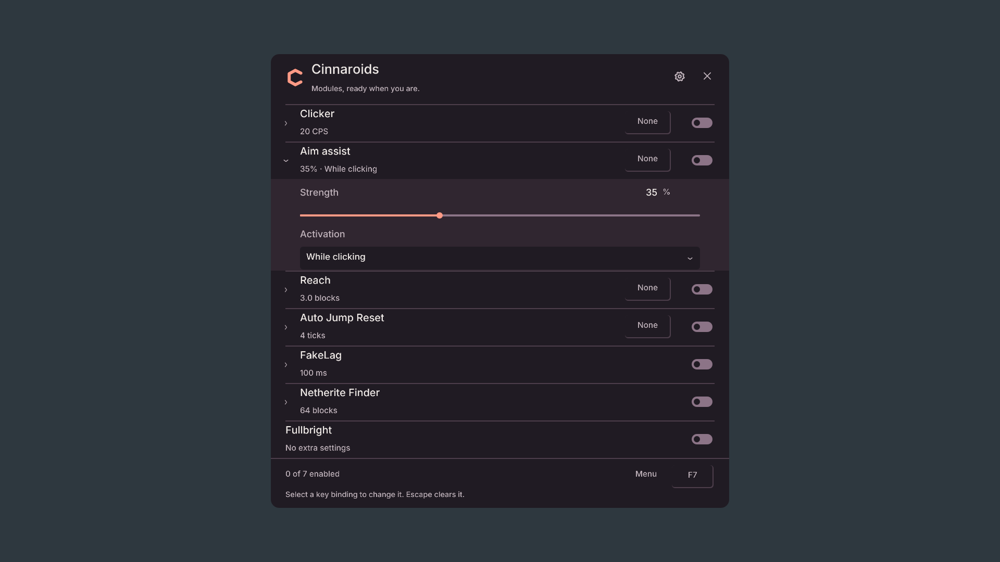

# Cinnaroids

Clicker, aim assist, reach, FakeLag, Player ESP, Netherite Finder, Fullbright and Auto Jump Reset for Cinnabar, controlled in-game with **F7**.



Download `cinnaroids.wasm` from the [latest release](https://github.com/RestartFU/cinnaroids/releases/latest), then open **Settings → Mods → Import** in an updated Cinnabar. Select the file, review its requested permissions, and enable it. Cinnabar manages loading and settings; no launcher is needed. [Installation and updates](docs/install.md).

**F7** opens the panel. Module shortcuts start unbound, and modules start disabled. Change bindings and preferences in the panel. [Module behavior](docs/modules.md).

The panel is a classic ClickGUI: Combat, Network, Render and Settings columns float over the softened world. Click a module to toggle it, and use its arrow to open settings beneath it; several can stay open at once. Drag a column by its header to move it, or click the header to collapse it; positions and collapsed columns are saved. The **Settings** column contains the menu key and **Reset layout**. Press Escape while setting a module keybind to clear it; Escape cancels capture for the Menu key.

Build with Rust 1.99.0, the `wasm32-unknown-unknown` target, and Python 3.11 or newer:

```sh
python3 scripts/build-cinnaroids.py
cargo test --locked -p cinnaroids-mod
python3 -m unittest discover -s scripts/tests -v
```

The output is `dist/cinnaroids.wasm` and its SHA-256 checksum. The component embeds its Mods-card metadata, requested permissions, icon, Inter Medium panel font, retained UI catalog and license notices. Packaging validates it and rejects WASI imports. The SDK is pinned in the workspace manifest to Cinnabar commit `8b082806d1a7d2fd5110c4467fbedef5a6d2a1b1`.

Opening blurs and dims the world while the columns settle in; closing reverses it. Toggles, disclosures, chevrons and key capture ease with Cinnabar's surface transitions, and drags follow the pointer directly. The client's **Screen animations** preference controls all motion; use a Cinnabar build containing the merged surface-animation support.

Edit the layout in `scripts/generate-panel.py`, then run it to regenerate `mods/cinnaroids/ui/panel.json`. Builds check that the generated file is current.

To publish, open **Actions → Release → Run workflow** and select **patch**, **minor**, or **major**. The workflow bumps the shared workspace version and lockfile, commits and tags `vX.Y.Z`, tests and builds the module, then publishes the WASM and checksum. A matching pushed version tag also releases. Failed jobs can be re-run; a manual run recovers an unpublished tag at the default branch's HEAD without bumping twice.

Cinnaroids source and original assets use the MIT license. The Cinnabar SDK has its own PolyForm Noncommercial license; see [third-party notices](THIRD_PARTY_NOTICES.txt). Cinnaroids is independent of Cinnabar and its maintainers.
